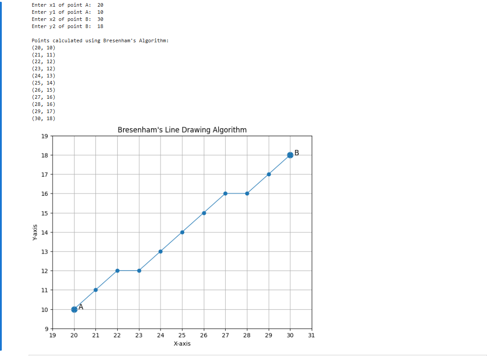
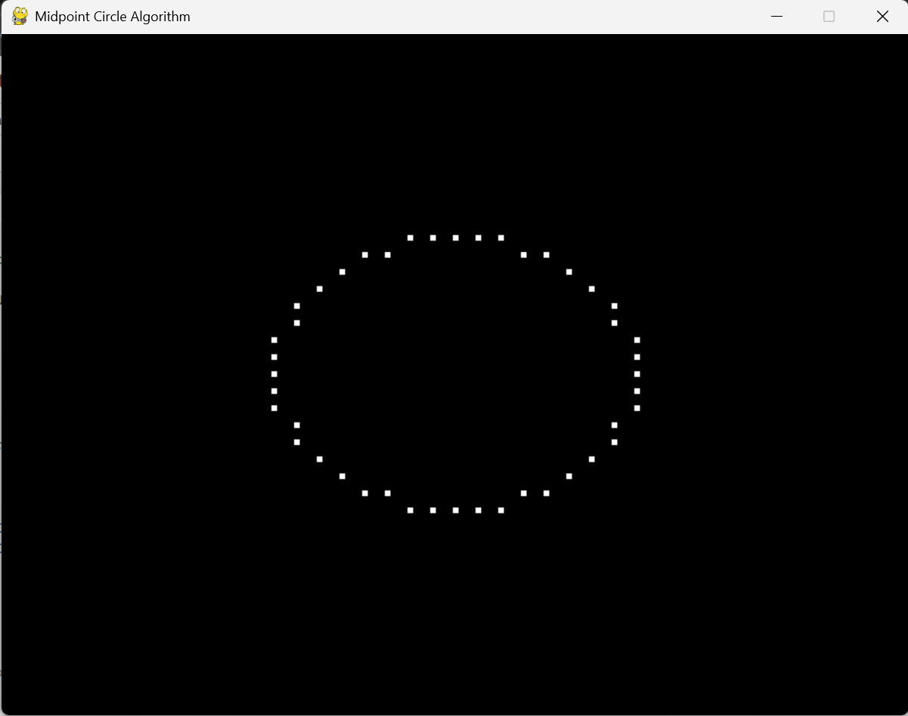
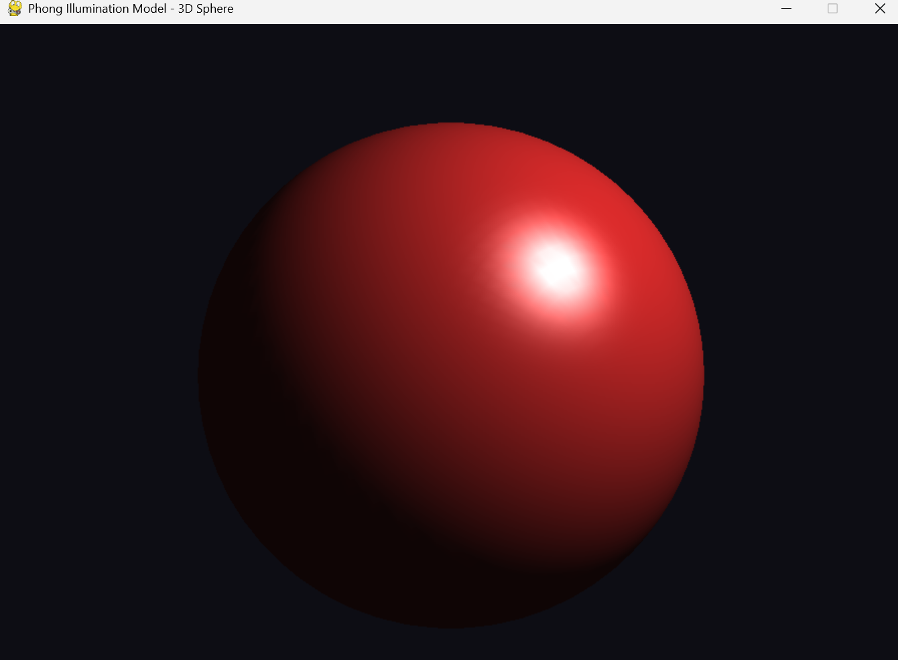
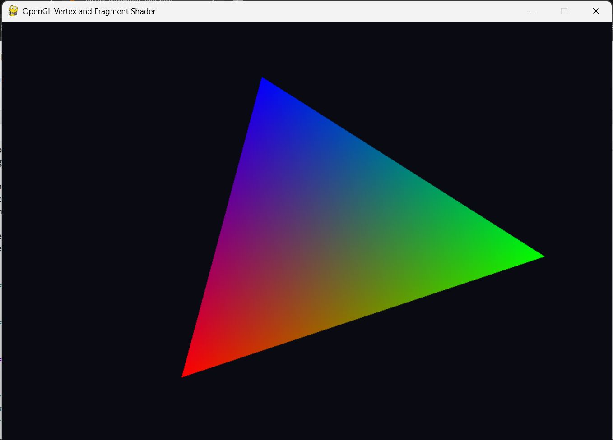
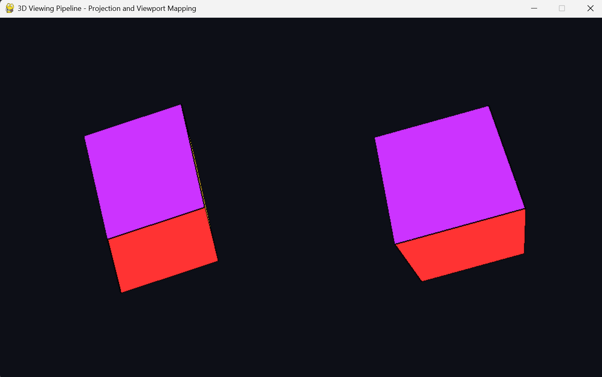

# Computer Graphics and Virtual Reality — Lab Programs

A consolidated collection of **Computer Graphics and Virtual Reality (CGVR)** laboratory programs with runnable source code, Jupyter notebooks, output screenshots, OpenGL implementations, shader examples, and a Unity interactive 3D scene.

All files are organized by **lab number** and use clear names such as `filename_labN`.

## Lab Index

| Lab | Experiment | Main files |
|---|---|---|
| **Lab 1** | DDA and Bresenham line drawing algorithms | `dda_line_lab1.py/.ipynb`, `bresenham_line_lab1.py/.ipynb` |
| **Lab 2** | Midpoint Circle Drawing Algorithm | `midpoint_circle_lab2.py/.ipynb` |
| **Lab 3** | 2D transformations using homogeneous coordinates | `2d_transformations_lab3.py/.ipynb` |
| **Lab 4** | Composite transformations using matrix representation | `composite_transformations_lab4.py/.ipynb` |
| **Lab 5** | Cohen–Sutherland line clipping algorithm | `cohen_sutherland_line_clipping_lab5.py/.ipynb` |
| **Lab 6** | Z-buffer hidden surface removal | `z_buffer_hidden_surface_removal_lab6.py/.ipynb` |
| **Lab 7** | Phong illumination model | `phong_illumination_lab7.py/.ipynb` |
| **Lab 8** | OpenGL vertex and fragment shaders | `vertex_fragment_shaders_lab8.py/.ipynb` |
| **Lab 9** | Interactive 3D scene using Unity | `unity_interactive_scene_lab9/` |
| **Lab 10** | 3D viewing pipeline, projection and viewport mapping | `3d_viewing_pipeline_lab10.py/.ipynb` |

## Repository Structure

```text
Computer-Graphics-and-Virtual-Reality/
├── lab1/
│   ├── dda_line_lab1.py
│   ├── dda_line_lab1.ipynb
│   ├── bresenham_line_lab1.py
│   ├── bresenham_line_lab1.ipynb
│   └── *_output_*_lab1.png
├── lab2/
├── lab3/
├── lab4/
├── lab5/
├── lab6/
├── lab7/
├── lab8/
├── lab9/
│   └── unity_interactive_scene_lab9/
└── lab10/
```

## Output Preview

### Lab 1 — DDA & Bresenham




### Lab 2 — Midpoint Circle



### Lab 3 — 2D Transformation


### Lab 5 — Cohen–Sutherland Clipping


### Lab 6 — Z-Buffer


### Lab 7 — Phong Illumination



### Lab 8 — Vertex & Fragment Shaders



### Lab 10 — 3D Viewing Pipeline



## Technologies Used

- Python
- NumPy
- Pygame
- PyOpenGL
- OpenGL / GLSL
- Jupyter Notebook
- Unity / C#

## Installation

```bash
pip install -r requirements.txt
```

Typical Python dependencies are:

```text
pygame
PyOpenGL
PyOpenGL_accelerate
numpy
```

Run any Python experiment directly, for example:

```bash
python lab5/cohen_sutherland_line_clipping_lab5.py
```

or open the corresponding `.ipynb` file in Jupyter Notebook / VS Code.

## Lab 9 — Unity

The Lab 9 folder contains the C# scripts and automatic scene builder for the interactive Unity scene. It demonstrates:

- player movement and jumping
- third-person camera follow
- obstacles and rotating objects
- collectible objects and score tracking
- directional lighting
- runtime HUD
- automatic scene generation

Unity version used: **6000.3.0f1**.

## Notes

- Output screenshots were consolidated from the individual lab repositories.
- The Python programs in this repository are cleaned consolidated versions intended to be directly readable and runnable.
- Lab 3 includes translation, rotation, scaling, reflection and shearing using homogeneous matrices.
- Lab 4 demonstrates composite transformations through matrix multiplication.
- Lab 6 contains the corrected OpenGL depth-buffer setup using `pygame.GL_DEPTH_SIZE`.
- Labs 7, 8 and 10 contain complete runnable code even though some of the original standalone notebooks were empty.

## Author

**MOHAMMMAD ARBAB MOHSIN**

Computer Graphics and Virtual Reality Laboratory
